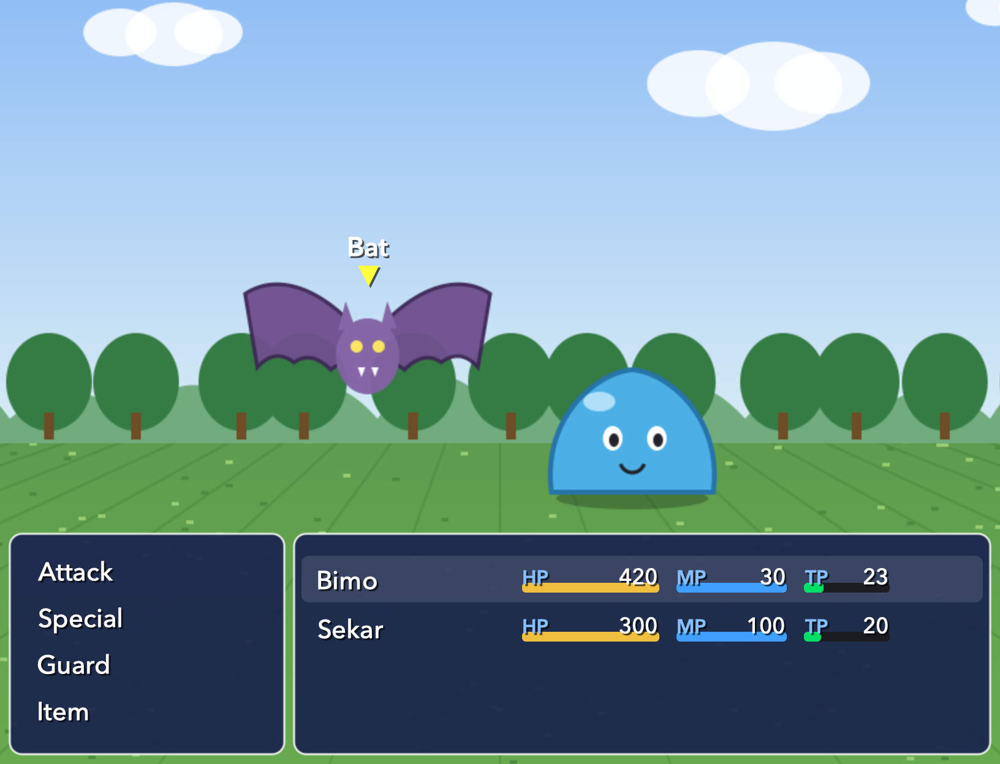

# Lakon

A native **macOS** RPG maker, modelled on how RPG Maker MZ works. You paint tile maps, script events with
MZ's page/condition/command model, edit a database, playtest, and export a standalone `.app`.


| Intro picture | Name input | Dialogue |
|---|---|---|
|  |  |  |
| **Battle** | **Skills** | **Shop** |
|  |  |  |
| **Menu** | **Equip** | **World: rain + ship + airship** |
|  |  |  |

Database: 

- **How MZ works, with source citations:** [docs/EVIDENCE.md](docs/EVIDENCE.md)
- **Architecture, decisions, scope:** [docs/DESIGN.md](docs/DESIGN.md)

## Build & run

```bash
scripts/build-app.sh          # → build/Lakon.app (release, ad-hoc signed)
open build/Lakon.app
swift test                    # 25 core tests (tiles, events, battle, shop, scripts, vehicles, save/load)
```

Requires macOS 14+ and Xcode 16+ (Swift 6 toolchain).

## Using it

- **New Project…** creates a demo with synthesised music and sounds, a full database and four maps. The village has a shop, an inn, a guessing game, a chest and a boat. In the house a second hero joins. The world map has random encounters, rain, a ship, an airship, a campfire driven by a plugin command, and a boss battle.
  Press **⌘R** to play it. Controls: arrows move, Z/Enter/Space to confirm, X/Esc for the menu.
- **Map mode (⌘1):** choose a tile in the palette and drag across it for a multi-tile brush. Option-click the map to pick up a tile.
- **Event mode (⌘2):** double-click a cell to create or edit an event. Drag events to move them. Right-click for quick
  events and to set the starting position.
- **Region mode (⌘3):** paint region IDs.
- **Database (⌘D):** actors, classes, skills, items, weapons, armors, enemies, troops (drag-to-place), states, tilesets (○ × ☆), common events, system, audio & vehicles.
- **Map properties:** BGM/BGS autoplay, battlebacks, random encounters (troop, weight, regions).
- **Import RPG Maker MZ Project…:** copies an MZ/MV project's `data/` and `img/` into a new Lakon project. The source is never modified.
- **Export as Mac App (⌘E):** produces `<Title>.app`, which boots straight into the game.

Your own assets work if they use MZ's layouts: `img/tilesets`, `img/characters`, `img/faces`, `img/enemies`, `img/battlebacks1/2`, `img/pictures`, `img/system/IconSet.png`, and `audio/{bgm,bgs,me,se}` (`.ogg` with loop tags, `.wav`, `.m4a`, `.mp3`). Scripts and plugins are JavaScript: see `plugins/LakonDemo.js` in a new project.

## CLI helpers

```bash
Lakon --make-sample <dir>                 # create the demo project
Lakon --import <mzProject> <dir>          # import an MZ project
Lakon --render-map <project> <id> <png>   # render a map to PNG
Lakon --export <project> <outDir>         # build a standalone game .app
Lakon --decode-audio <file.ogg>           # check audio decoding / loop tags
```
